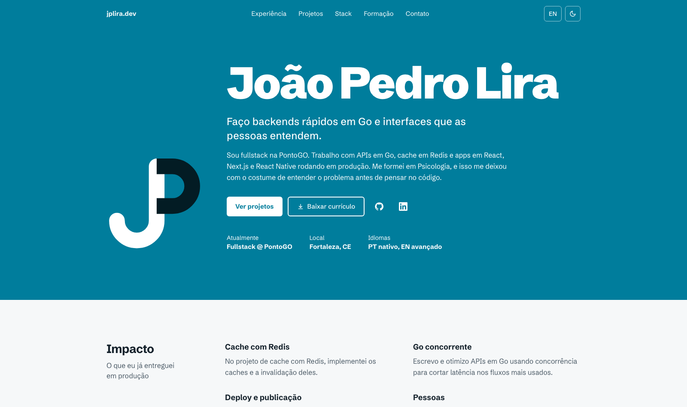

# Portfolio: João Pedro Lira

[](https://github.com/lirajoaop/jlira-portfolio/actions/workflows/ci.yml)

**Live:** [jplira.dev](https://jplira.dev)

<picture>
  <source media="(prefers-color-scheme: dark)" srcset="docs/screenshot-dark.png">
  
</picture>

Personal website built with **Next.js 15 (App Router) + TypeScript + Tailwind CSS 4**. It's bilingual (PT at `/`, EN at `/en`), has light and dark themes, and every page is statically generated.

## Running locally

```bash
npm install
npm run dev      # http://localhost:3000
npm run build    # production build
npm run typecheck  # TypeScript check (run after a build)
```

## Updating the content

**All copy lives in `src/content/content.ts`.** Experience, projects, stack and education are all in that file, in PT and EN. To add a project, add an item to `projects.items` in both languages and put its images in `public/projects/`.

- Downloadable résumé: `public/curriculo-joao-pedro-lira.pdf`
- Components: `src/components/`
- SEO (metadata, Open Graph, JSON-LD, sitemap, robots): `src/lib/shell.tsx`, `src/lib/og.tsx`, `src/app/sitemap.ts`

## Deployment

On Vercel: import the repository and Next.js is detected automatically, with no extra configuration.

## License

The code is released under the [MIT License](LICENSE). Personal content is not covered: the texts about me, the résumés in `public/` and the images and project screenshots remain all rights reserved.
